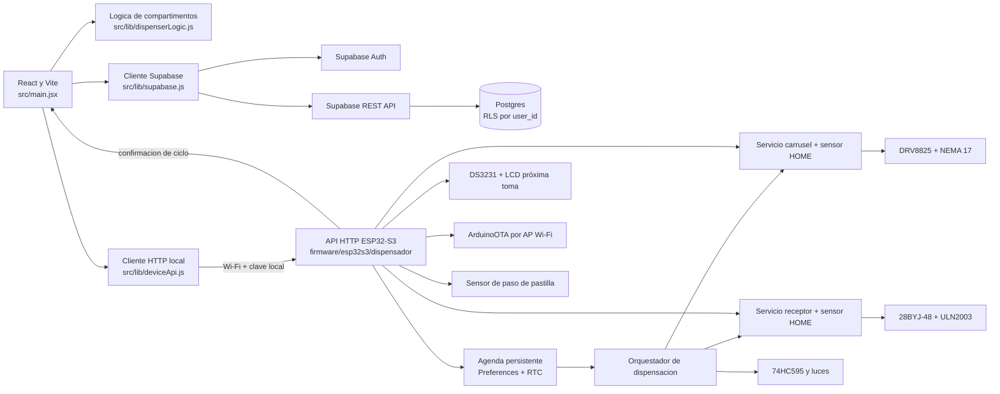
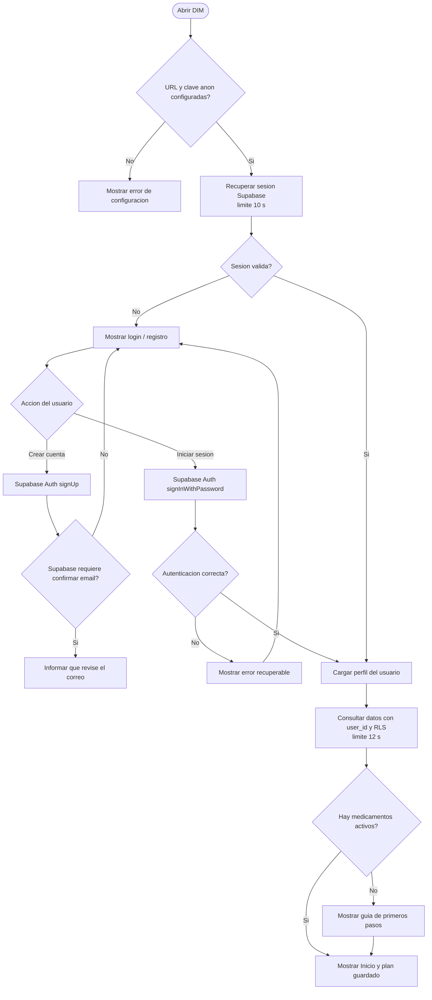
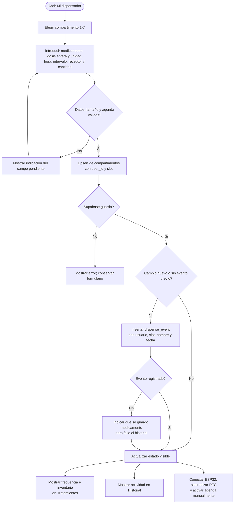

# Software y firmware DIM

## Alcance y estado

La aplicacion web guarda perfiles, siete compartimentos, ajustes, notificaciones y eventos por usuario en Supabase. El firmware ESP32-S3 integrado expone controles HTTP locales autenticados para el carrusel, el motor receptor, luces, prueba de audio, sensores y DS3231. La agenda configurada por medicamento se copia al almacenamiento persistente del ESP32 para ejecutarse aunque la app este cerrada.

Cada agenda tiene nombre, tamaño de pastilla, hora inicial, intervalo de 1-168 horas, cantidad por toma e inventario local. Visto desde arriba, la secuencia del disco es horaria: grande en HOME, pequeña a 90°, mediana a 180° y cerrado a 270°. El firmware ejecuta carrusel → alineación de 22,5° → selección de cavidad → retorno/vibración de 2 s → carrusel a HOME → media vuelta horaria del disco. Cuenta los flancos de caída del sensor; si no detecta una pastilla, intenta volver a cerrado, detiene la toma y bloquea el compartimento sin reintentar. Solo descuenta el inventario después de completar y detectar toda la toma. Las dosis atrasadas más de cinco minutos se omiten. La app reconcilia el stock al volver a conectarse. El horario de bloqueo de la app no es un interbloqueo físico para la agenda. El sensor confirma un paso por su haz, no que la pastilla haya sido ingerida. El panel local ofrece pruebas manuales de los motores, Q0/Q1-Q7 y una pista de audio.

## Arquitectura actual



## Flujo de inicio y autenticacion



## Flujo de alta o modificacion de medicamento



## Sketches heredados

Los sketches antiguos de Uno/ESP32 son solo pruebas aisladas y no forman parte de la secuencia integrada. El firmware actual usa 200 micropasos por posición de 45° para el carrusel y 1024 medios pasos aproximados por cuarto de vuelta del 28BYJ-48.

## Modulos y ubicacion del codigo

| Modulo | Codigo actual | Responsabilidad |
| --- | --- | --- |
| Interfaz y flujo de pantallas | [`src/main.jsx`](../src/main.jsx) | Auth, estado de sesion, onboarding, configuracion y vistas. |
| Acceso a Supabase | [`src/lib/supabase.js`](../src/lib/supabase.js) | Auth, consultas por usuario, guardado de compartimentos y eventos. |
| Reglas locales | [`src/lib/dispenserLogic.js`](../src/lib/dispenserLogic.js) | Angulos, disponibilidad y bloqueo nocturno. |
| API local del dispositivo | [`src/lib/deviceApi.js`](../src/lib/deviceApi.js) | Rutas versionadas, clave local y limites de posiciones/compartimentos. |
| Esquema de base | [`database/schema.sql`](../database/schema.sql) | Tablas, claves y politicas RLS. |
| Migraciones | [`database/migrate_user_scoping.sql`](../database/migrate_user_scoping.sql), [`database/migrate_medication_frequency.sql`](../database/migrate_medication_frequency.sql), [`database/migrate_medication_pill_size.sql`](../database/migrate_medication_pill_size.sql) | Actualizacion de proyectos Supabase ya creados. |
| Firmware integrado | [`firmware/esp32s3/dispensador`](../firmware/esp32s3/dispensador/README.md) | API HTTP, secuencia de dispensacion, luces, RTC, LCD y OTA para ESP32-S3. |
| Pruebas heredadas ESP32 | [`firmware/legacy_esp32`](../firmware/legacy_esp32) | Sketches conservados; no son el firmware integrado. |
| Prueba heredada Uno | [`firmware/arduino_uno`](../firmware/arduino_uno) | Sketch de control manual para Arduino Uno. |
| Pruebas web | [`src/lib/dispenserLogic.test.js`](../src/lib/dispenserLogic.test.js) | Reglas de compartimentos, ventana nocturna y utilidades. |

## Estructura del repositorio

Mantener una sola fuente de verdad: la aplicacion en `src/`, SQL en `database/`, documentacion en `docs/` y firmware separado por placa. No copiar implementaciones completas dentro de la documentacion; los diagramas explican los flujos y los archivos de firmware contienen el codigo ejecutable.

```text
DIM/
  docs/
    software-firmware.md
  src/
    main.jsx
    lib/
      supabase.js
      dispenserLogic.js
  database/
    schema.sql
    migrate_user_scoping.sql
    migrate_medication_frequency.sql
  firmware/
    esp32s3/dispensador/
      include/                 # configuracion y servicios
      src/                     # API HTTP, motores, RTC y LCD
      platformio.ini
    legacy_esp32/              # pruebas anteriores
    arduino_uno/
      motor_drv8825_arduino_uno.ino
  .env.example
  .gitignore
  package.json
```

El firmware integrado se compila con PlatformIO desde su carpeta. Los sketches de prueba se mantienen aparte para evitar cargar por error un programa de placa distinta.

## Seguridad y pasos pendientes

- No subir `.env`, claves privadas ni contrasenas de Wi-Fi al repositorio. Para Vite solo debe exponerse la clave anonima; nunca una `service_role`.
- Ejecutar las migraciones SQL en el proyecto Supabase antes de usar las columnas `user_id` y `frequency_hours`.
- Cambia las credenciales Wi-Fi, la clave API y la clave del AP antes de cargar firmware; no expongas el puerto HTTP local a Internet.
- GPIO46 controla EN del DRV8825 y es un pin de strap; el firmware lo inicializa deshabilitado lo antes posible, pero sin un pull-up externo el driver puede quedar habilitado durante reset. Verifica el arranque con el mecanismo despejado.
- El sensor de caída se cuenta por flanco; un fallo detiene y bloquea la toma sin reintentar. Valida falsos positivos/negativos y tiempo de caída con pastillas ficticias antes de conectar medicamentos.
- El panel permite probar manualmente cualquier pista del DFPlayer (1–3000), pero no se asignan automáticamente mensajes a eventos hasta que se definan los números de pista y la organización de la tarjeta SD.
- ArduinoOTA requiere una tabla de particiones con dos espacios OTA y solo puede usarse tras instalar una primera versión OTA-capaz.
- Para conectar la app, el ESP32 debe ejecutar el firmware DIM compatible. Si otro firmware responde con 404 o no implementa la API local, actualízalo por su OTA actual (si es compatible con ArduinoOTA); no hace falta USB si el cargador OTA existente acepta esta imagen.
- La API HTTP local requiere que telefono y ESP32 compartan red. Un sitio HTTPS no puede llamar directamente al ESP32 por HTTP en navegadores que bloquean contenido mixto.
- El horario personalizado se valida en la app, pero no es un interbloqueo fisico del motor.
- La clasificacion regulatoria y la normativa biomedica aplicable, incluida la posible categoria SaMD, deben revisarse antes de cualquier uso clinico.
- Validacion web: `npm test` y `npm run build`. Para el firmware integrado se necesita PlatformIO y una ESP32-S3.
