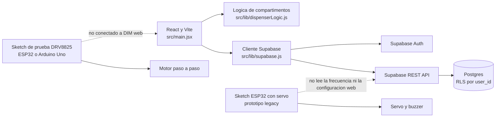
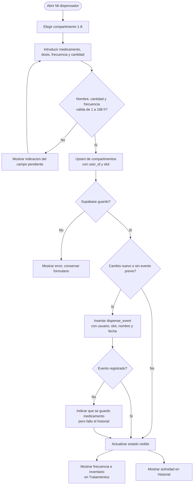
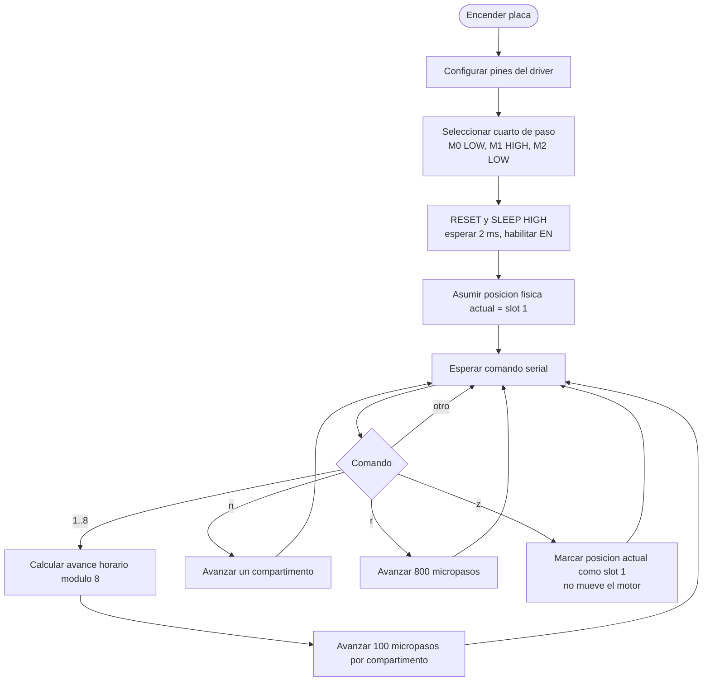

# Software y firmware DIM

## Alcance y estado

Este documento describe los flujos que implementa actualmente el repositorio. La aplicacion web guarda perfiles, compartimentos, ajustes, notificaciones y eventos por usuario en Supabase. Los sketches DRV8825 son pruebas manuales de movimiento; no reciben ordenes desde la app ni dispensan medicamentos automaticamente.

La frecuencia guardada por medicamento es un intervalo informativo en horas (1-168). No crea alarmas ni programa el motor. Cada usuario puede elegir en Ajustes el horario en el que la app marca los compartimentos como no disponibles. Es una regla de software; no detiene fisicamente el motor. El firmware servo actual usa `millis()` como si fuera hora real y no debe usarse para controlar dosis.

## Arquitectura actual



## Flujo de inicio y autenticacion


## Flujo de alta o modificacion de medicamento



## Flujo del sketch de prueba DRV8825



Con un motor de 200 pasos completos por vuelta, cuarto de paso produce 800 micropasos por vuelta. Ocho posiciones uniformes requieren 100 micropasos (45 grados) por compartimento. La velocidad configurada es una referencia; el tiempo real depende del motor, corriente, carga y fuente.

## Modulos y ubicacion del codigo

| Modulo | Codigo actual | Responsabilidad |
| --- | --- | --- |
| Interfaz y flujo de pantallas | [`src/main.jsx`](../src/main.jsx) | Auth, estado de sesion, onboarding, configuracion y vistas. |
| Acceso a Supabase | [`src/lib/supabase.js`](../src/lib/supabase.js) | Auth, consultas por usuario, guardado de compartimentos y eventos. |
| Reglas locales | [`src/lib/dispenserLogic.js`](../src/lib/dispenserLogic.js) | Angulos, disponibilidad y bloqueo nocturno. |
| Esquema de base | [`database/schema.sql`](../database/schema.sql) | Tablas, claves y politicas RLS. |
| Migraciones | [`database/migrate_user_scoping.sql`](../database/migrate_user_scoping.sql), [`database/migrate_medication_frequency.sql`](../database/migrate_medication_frequency.sql) | Actualizacion de proyectos Supabase ya creados. |
| Prueba de motor para ESP32 | [`esp32/motor_paso_a_paso_drv8825.ino`](../esp32/motor_paso_a_paso_drv8825.ino) | Control manual serial del DRV8825; sin sensor ni agenda automatica. |
| Prototipo ESP32 con servo | [`esp32/dispensador_esp32.ino`](../esp32/dispensador_esp32.ino) | Prototipo separado; requiere correcciones antes de uso real. |
| Prueba de motor para Uno | [`arduino_uno/motor_drv8825_arduino_uno.ino`](../arduino_uno/motor_drv8825_arduino_uno.ino) | Control manual serial del DRV8825 en Arduino Uno. |
| Pruebas web | [`src/lib/dispenserLogic.test.js`](../src/lib/dispenserLogic.test.js) | Reglas de compartimentos, ventana nocturna y utilidades. |

## Estructura recomendada del repositorio

Mantener una sola fuente de verdad: la aplicacion en `src/`, SQL en `database/`, documentacion en `docs/` y firmware separado por placa. No copiar implementaciones completas dentro de la documentacion; los diagramas explican los flujos y los archivos de firmware contienen el codigo ejecutable.

```text
DIM/
  docs/
    software-firmware.md
  src/
    main.jsx
    lib/
      supabase.js
      dispenserLogic.js
  database/
    schema.sql
    migrate_user_scoping.sql
    migrate_medication_frequency.sql
  firmware/
    esp32/
      drv8825_test/
        drv8825_test.ino
      servo_prototype/
        servo_prototype.ino
    arduino_uno/
      drv8825_test/
        drv8825_test.ino
  .env.example
  .gitignore
  package.json
```

La estructura anterior es una propuesta, no una reubicacion automatica de los archivos actuales. Arduino IDE suele trabajar mas claramente cuando cada sketch tiene su propia carpeta y el `.ino` principal comparte el nombre de esa carpeta. Mantener sketches de placas distintas separados evita cargar por error el programa incorrecto.

## Seguridad y pasos pendientes

- No subir `.env`, claves privadas ni contrasenas de Wi-Fi al repositorio. Para Vite solo debe exponerse la clave anonima; nunca una `service_role`.
- Ejecutar las migraciones SQL en el proyecto Supabase antes de usar las columnas `user_id` y `frequency_hours`.
- `esp32/dispensador_esp32.ino` contiene valores de ejemplo, usa tiempo desde arranque como reloj y hace una accion de prueba al iniciar. No es firmware clinico ni debe conectarse a un dispensador real sin RTC, autenticacion por dispositivo, lectura de configuracion, limites y validacion fisica.
- Los sketches DRV8825 solo aceptan comandos manuales por Serial. No consultan Supabase, no calculan proximas dosis y no deben considerarse un sistema de dispensacion automatica.
- El horario personalizado se valida en la app, pero aun no se sincroniza con el firmware ni bloquea el motor fisicamente.
- La clasificacion regulatoria y la normativa biomedica aplicable, incluida la posible categoria SaMD, deben revisarse antes de cualquier uso clinico.
- Validacion web del repositorio: `npm test` y `npm run build`. Para compilar firmware se necesita Arduino IDE o Arduino CLI, la placa correcta y las librerias correspondientes.
